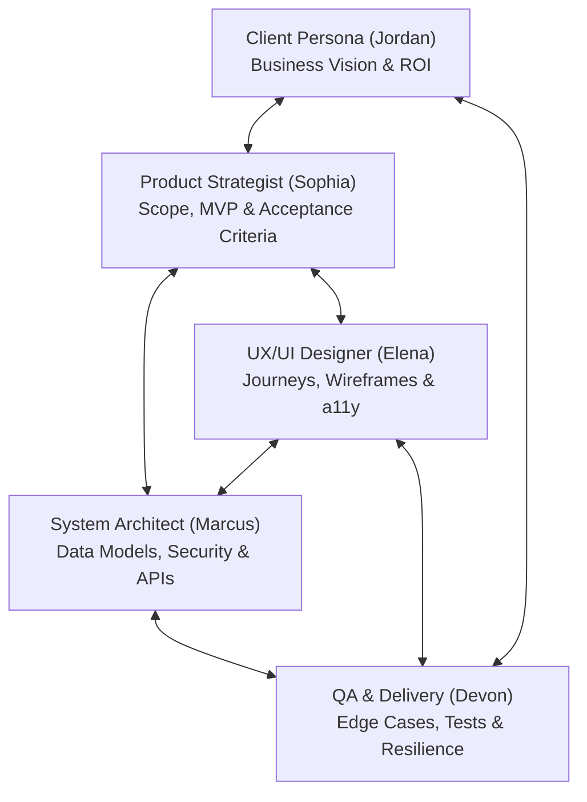

# App Building Persona Skills Suite

This directory contains specialized persona skills designed for collaborative application development. Each persona brings a distinct specialty, philosophy, and evaluation checklist, while adhering to team collaboration protocols.

---

## The Persona Roster

| Persona Skill | Identity | Key Specialty | Primary Focus |
| :--- | :--- | :--- | :--- |
| [`persona-system-architect`](./persona-system-architect/SKILL.md) | Marcus Vance | Architecture & Tech Lead | Modularity, data schemas, security, performance, API contracts. |
| [`persona-ux-designer`](./persona-ux-designer/SKILL.md) | Elena Cruz | UX/UI & Frontend Specialist | User journeys, wireframes, component design, a11y, micro-interactions. |
| [`persona-qa-delivery`](./persona-qa-delivery/SKILL.md) | Devon Patel | QA & Pragmatic Delivery | Edge-case hunting, test suites, resilience, CI/CD, velocity. |
| [`persona-product-manager`](./persona-product-manager/SKILL.md) | Sophia Chen | Product Strategist & Scoping | MoSCoW prioritization, acceptance criteria (BDD), MVP scoping. |
| [`persona-client`](./persona-client/SKILL.md) | Jordan Avery | Client & Business Sponsor | ROI, real-world customer expectations, non-technical feedback, UAT. |

---

## Team Dynamic & Workflow Matrix

---

## How to Use These Personas

### 1. Solo Consultation
Ask the assistant to adopt a single persona for a targeted task:
- *"Adopt the System Architect persona and design a SQLite schema for a note-taking app."*
- *"Adopt the UX Designer persona and design the onboarding flow for a mobile app."*
- *"Adopt the QA Engineer persona and find edge cases in this authentication workflow."*
- *"Adopt the Client persona and give feedback on this feature proposal."*

### 2. Multi-Persona Team Review (Roundtable)
Ask the assistant to conduct a team critique with all personas:
- *"Run an App Team Roundtable: Have the Product Manager, UX Designer, System Architect, and QA Engineer review this app idea and discuss trade-offs."*

### 3. Client Simulation & Pitch Practice
Test how your app or pitch holds up against stakeholder feedback:
- *"Act as the Client persona in 'Non-Technical Business Owner' mode. I will present our project plan, and you ask questions about cost, usability, and timeline."*

---

## Visual Verification & Testing Skills

| Skill | Engine | Primary Focus | Best Phase |
| :--- | :--- | :--- | :--- |
| [`visual-testing-evaluator`](./visual-testing-evaluator/SKILL.md) | Decision Matrix & Orchestrator | Evaluates when to use Puppeteer MCP vs Playwright scripts | All Phases (Planning & Triage) |
| [`webapp-testing`](./webapp-testing/SKILL.md) | Python Playwright + `with_server.py` | Multi-step user journeys, dev-server lifecycle, console error capture, automated acceptance tests | Feature Done, Acceptance, Regressions |
| **Puppeteer MCP** | Chrome MCP Tool Calls | Fast, interactive in-chat DOM inspection and immediate snapshots on running servers | Rapid CSS/Layout Iteration |

