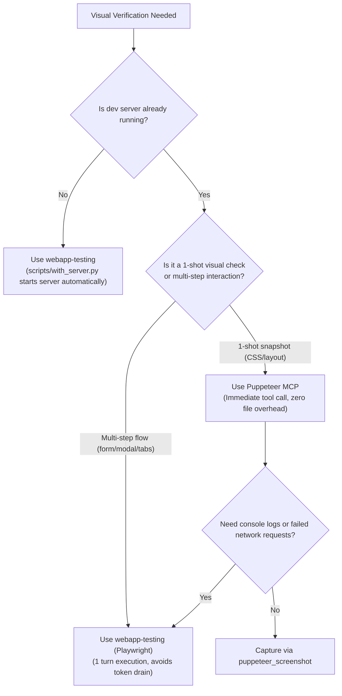

# Visual Testing & Verification Evaluator

This skill guides agents to evaluate and select the best browser testing and visual screenshot tool between **Puppeteer MCP** (interactive tool calling) and **`webapp-testing`** (automated Playwright scripts with server lifecycle management).

---

## Tool Overview & Capability Comparison

| Attribute | Puppeteer MCP Server | `webapp-testing` (Playwright Skill) |
| :--- | :--- | :--- |
| **Execution Model** | Interactive chat tool calls (`call_mcp_tool`) | Standalone Python scripts executed via shell |
| **Server Requirement** | **External / Pre-running** (Agent assumes dev server is active) | **Automated** (`with_server.py` handles start, health check, cleanup) |
| **Token Efficiency** | Consumes tokens/turns per action (navigate, click, snap) | Single turn execution for arbitrary sequence of steps |
| **Console & Network Logs** | Basic output | Comprehensive browser logs and exception traces |
| **Artifacts** | Screenshots captured to chat / base64 | Screenshots saved to disk / artifacts directory |
| **Best Scenario** | Quick visual sanity check on an already running server | Full feature acceptance, multi-step user journeys, regressions |

---

## Phase-by-Phase Selection Matrix

### Phase 1: Rapid UI, CSS & Layout Tweaks
* **Context**: Adjusting margins, colors, typography, navbar responsiveness, or simple component styling.
* **Preferred Tool**: **Puppeteer MCP** (if dev server is already running)
* **Rationale**: Minimal latency. The agent can immediately trigger `puppeteer_screenshot` without writing and executing temporary Python script files.
* **Fallback**: If the dev server is not running in the background, use `webapp-testing` with `with_server.py`.

### Phase 2: Interactive Component & State Transitions
* **Context**: Modals, dropdowns, multi-step wizard, form validation errors, tab switches.
* **Preferred Tool**: **`webapp-testing` (Playwright)**
* **Rationale**: Multi-step interactions (e.g., click tab -> wait 200ms -> fill form -> click submit -> verify toast) executed via MCP burn 5–8 conversational turns. Writing a compact Playwright script executes the entire scenario in **1 turn**, avoiding context pollution and conversational drift.

### Phase 3: Feature Completion & Acceptance Criteria Verification
* **Context**: A story or ticket is marked complete; agent must prove acceptance criteria were met.
* **Preferred Tool**: **`webapp-testing` with `scripts/with_server.py`**
* **Rationale**:
  1. Guaranteed reproducible run independent of ambient terminal processes.
  2. Spawns the exact dev server command (`npm run dev`), waits for port readiness, runs tests across desktop/mobile viewports, and captures proof screenshots.
  3. Screenshots are cleanly placed into persistent paths (e.g., conversation brain artifacts or `screenshots/`).

### Phase 4: Bug Reproduction & Diagnostic Triage
* **Context**: Investigating visual anomalies, blank screens, hydration errors, or broken buttons.
* **Preferred Tool**: **`webapp-testing` (Playwright)**
* **Rationale**:
  * Captures browser console errors (`page.on("console", ...)`), uncaught exceptions, and failed HTTP requests (`page.on("requestfailed", ...)`).
  * Puppeteer MCP only returns the image or element text; Playwright captures the exact underlying stack trace causing the UI breakage.

### Phase 5: CI / Pre-Commit / Regression Suite
* **Context**: Creating permanent visual smoke tests to safeguard against future breakage.
* **Preferred Tool**: **`webapp-testing`**
* **Rationale**: Script files can be committed directly to `tests/e2e/` or `.agents/scripts/` to be re-run whenever changes occur.

---

## The Decision Flowchart



---

## Execution Recipes

### A. Executing Puppeteer MCP (Fast Sanity Check)
When the server is active on `http://localhost:5173`:
```json
// Step 1: Navigate
call_mcp_tool(
  ServerName: "puppeteer",
  ToolName: "puppeteer_navigate",
  Arguments: { "url": "http://localhost:5173" }
)

// Step 2: Screenshot
call_mcp_tool(
  ServerName: "puppeteer",
  ToolName: "puppeteer_screenshot",
  Arguments: { "name": "dashboard_sanity_check" }
)
```

### B. Executing `webapp-testing` with `with_server.py` (Full Automated Flow)
When verifying a feature or when the server is not pre-running:

```bash
python .agents/skills/webapp-testing/scripts/with_server.py \
  --server "npm run dev" --port 5173 \
  -- python -c "
from playwright.sync_api import sync_playwright

with sync_playwright() as p:
    browser = p.chromium.launch(headless=True)
    page = browser.new_page(viewport={'width': 1280, 'height': 800})
    page.goto('http://localhost:5173')
    page.wait_for_load_state('networkidle')
    page.screenshot(path='acceptance_desktop.png')
    browser.close()
print('Verification successful!')
"
```

---

## Collaboration with Personas

* **With `persona-qa-delivery` (Devon Patel)**:
  * Uses `webapp-testing` to write regression verification scripts, test edge cases (zero state, long strings), and verify error banners.
* **With `persona-ux-designer` (Elena Cruz)**:
  * Uses Puppeteer MCP for live visual critique of typography, alignment, and dark/light mode toggles.
* **With `persona-product-manager` (Sophia Chen)**:
  * Evaluates whether User Story Acceptance Criteria require a formal Playwright test run or a quick Puppeteer screenshot proof for the user.
