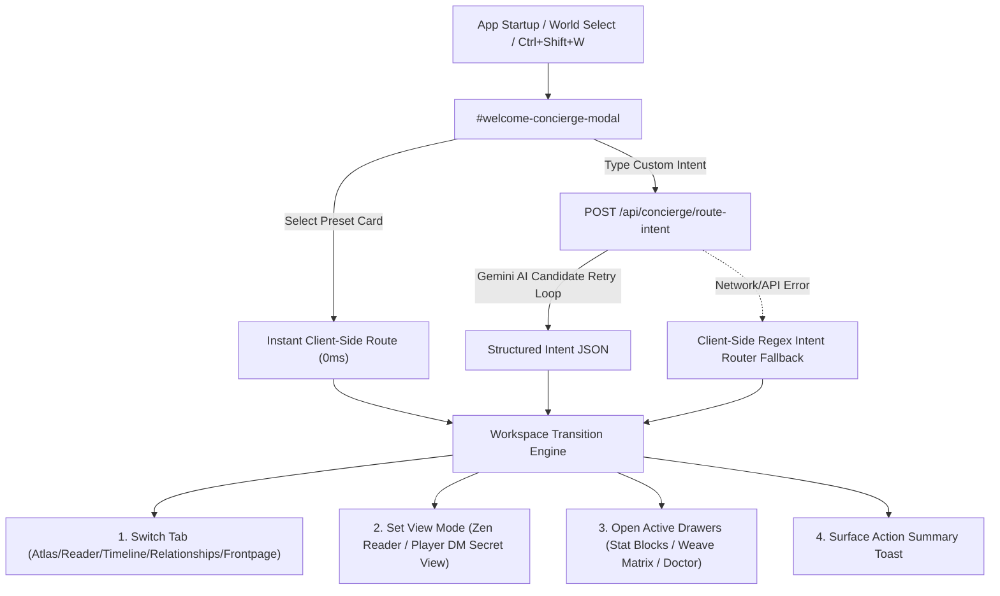

# Stage 2: Formal Design Specification & Gate 1 Report

**Feature Name**: AI Welcome Concierge & User Journey Launcher System  
**Date**: 2026-08-20  
**Status**: Approved (Gate 1 Auto-Approved)  

---

## 1. System Architecture



---

## 2. API Contract Specification
- **Endpoint**: `POST /api/concierge/route-intent`
- **Request Body**:
  ```json
  {
    "world_id": "1",
    "user_intent": "I want to finish writing the duel scene between Kaelen and the Dragon Lord"
  }
  ```
- **Response Payload**:
  ```json
  {
    "target_view": "reader",
    "enable_zen_mode": true,
    "open_drawer": "weave-matrix",
    "search_filter": "Kaelen Dragon Lord",
    "action_summary": "Opened Zen Reader Mode and staged Kaelen and Dragon Lord lore in your Weave Matrix context."
  }
  ```

---

## 3. UI Component Spec
- **Header Button**: `✨ Concierge` (`Ctrl + Shift + W`), placed in the top navbar dock.
- **Modal Overlay**: `#welcome-concierge-modal` featuring:
  - Header title & subheading greeting.
  - 4 Preset Intent Cards:
    - 🪐 **Bring Worlds to Life** (`view-atlas`, territory layers)
    - 📜 **Start Literary Journey** (`view-reader`, `.zen-mode`, Weave Matrix)
    - ⚔️ **DM Campaign Prep** (`#statblock-drawer`, DM secrets)
    - 🩺 **World Doctor Audit** (`#doctor-quick-fixes-hero`)
  - Custom prompt textarea (`#concierge-intent-input`) & action button (`#concierge-launch-btn`).
  - `[✓] Show Concierge on startup` checkbox (`#concierge-startup-checkbox`).
