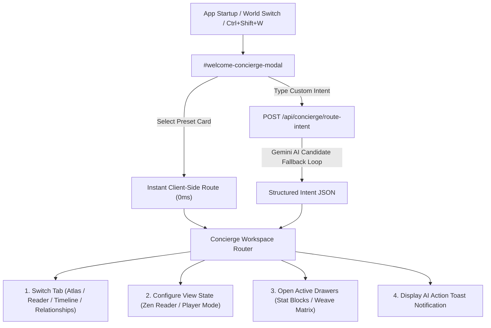

# AI Welcome Concierge & Journey Launcher Design Spec

**Date**: 2026-08-20  
**Status**: Approved  
**Target Feature**: AI-Powered Welcome Concierge & Workspace Launcher for LoreVault  

---

## 1. Overview & Purpose
LoreVault's AI Welcome Concierge greets users upon logging in or switching active worlds, asking whether they plan to bring their worlds to life (worldbuilding/atlas/factions) or start their literary journey (writer focus mode/weave matrix/chapter drafts).

The feature provides:
1. **Instant 0ms Preset Intent Cards** for common user journeys (Worldbuilding, Literary Writing, DM Prep, Canon Audit).
2. **Gemini LLM Intent Classifier** (`POST /api/concierge/route-intent`) for custom natural language queries.
3. **Workspace View Transition Engine** that automatically switches views, configures focus modes (Zen mode), opens drawers (Stat Blocks/Weave Matrix), and surfaces action summary notifications.
4. **Hotkey & Header Accessibility** (`Ctrl + Shift + W` and header icon) for re-launching the Concierge at any time.

---

## 2. Architecture & Data Flow



---

## 3. Component Details

### 3.1 UI Components (`public/index.html` & `public/css/styles.css`)
- **Header Button**: `✨ Concierge` button added to top navigation bar alongside Command Palette (`Ctrl + K`).
- **Modal Overlay (`#welcome-concierge-modal`)**:
  - Glassmorphic modal backdrop with smooth fade animation.
  - Heading: `"Welcome back to LoreVault"` with current world badge.
  - Subheading: `"Were you planning on bringing your worlds to life or starting your literary journey today?"`
  - **4 Preset Intent Cards Grid**:
    - 🪐 **Bring Worlds to Life** (Worldbuilder): Navigates to Atlas view, expands territory layers, closes Zen mode.
    - 📜 **Start Literary Journey** (Writer Focus): Navigates to Reader/Editor, enables Zen Focus Mode (`.zen-mode`), stages active article into Weave Matrix.
    - ⚔️ **DM Campaign Prep** (Game Master): Opens Stat Block Engine drawer (`#statblock-drawer`), sets Player Secret toggle.
    - 🩺 **World Doctor Audit** (Canon Doctor): Triggers Narrative Audit check and opens health cards.
  - **Custom Natural Language Input**:
    - Textarea input with placeholder: `"Or describe what you're working on... e.g. 'Help me draft a duel between Kaelen and the Dragon Lord'"`
    - Action Button: `✨ Launch Journey` (`Enter`).
    - Spinner loading state during Gemini LLM intent processing.
  - **Footer Controls**:
    - `[✓] Show Concierge on startup` checkbox tied to `localStorage.getItem('lorevault_show_concierge')`.
    - `Esc` hotkey and `✕ Close` button to dismiss.

### 3.2 Client-Side Controller (`public/js/app.js`)
- **`ConciergeManager` Class / Helper**:
  - Checks startup preference on page load (`initConcierge()`).
  - Registers keyboard shortcut `Ctrl + Shift + W`.
  - Executes preset transitions instantly.
  - Sends custom intent requests to backend API `POST /api/concierge/route-intent`.
  - Executes workspace state transitions based on intent payload.

### 3.3 Backend API (`server.js`)
- **Endpoint**: `POST /api/concierge/route-intent`
- **Request Body**:
  ```json
  {
    "world_id": "1",
    "user_intent": "I want to write a duel scene between Kaelen and the Dragon Lord"
  }
  ```
- **Gemini Candidate Fallback Loop**: Uses centralized `callGeminiApi` with retry candidates (`gemini-flash-latest`, `gemini-2.0-flash`, `gemini-3.1-pro-preview`, `gemini-pro-latest`).
- **Response Payload Schema**:
  ```json
  {
    "target_view": "reader",
    "enable_zen_mode": true,
    "open_drawer": "weave-matrix",
    "search_filter": "Kaelen Dragon Lord",
    "action_summary": "Opened Zen Reader Mode and staged Kaelen and Dragon Lord lore in your Weave Matrix context."
  }
  ```

---

## 4. Verification & Testing Plan
1. **Automated API Integration Test**:
   - Add test case in `test/api-suite.js` verifying `POST /api/concierge/route-intent` parses sample text into structured JSON.
2. **Manual & UI Integration Verification**:
   - Verify modal opens on startup when `lorevault_show_concierge` is enabled.
   - Verify `Ctrl + Shift + W` hotkey toggles modal visibility.
   - Verify preset cards execute instant view transitions.
   - Verify custom typed inputs send payload, display loading spinner, and apply target view, Zen mode, and drawers.
