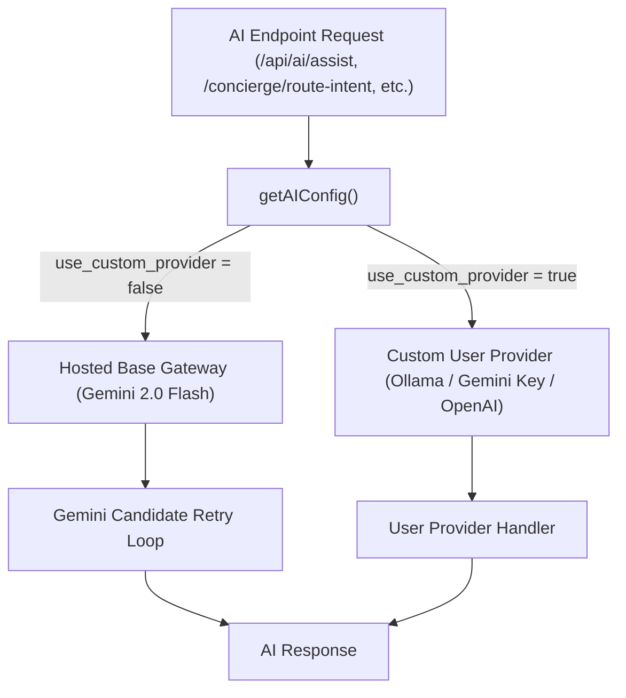

# Hosted Base Model & Custom AI Settings Design Spec

**Date**: 2026-08-20  
**Status**: Approved  
**Target Feature**: Default Hosted Base Model Gateway & Custom AI Model Settings Manager for LoreVault  

---

## 1. Overview & Purpose
LoreVault provides an out-of-the-box zero-setup AI experience using a built-in Hosted Base Model (`Gemini 2.0 Flash` via system proxy / environment default), eliminating the requirement for users to enter API keys to get started.

For power users who prefer custom privacy or alternative models, LoreVault features a **Dual-Tier AI Settings Manager** allowing seamless switching between the Hosted Base Model and custom providers (Ollama local, custom Gemini keys, OpenAI, OpenRouter) with live connection testing and header status feedback.

---

## 2. Architecture & Data Flow



---

## 3. Configuration Schema (`config/ai-config.json`)
```json
{
  "use_custom_provider": false,
  "default_model": "gemini-2.0-flash",
  "custom_provider": "gemini",
  "custom_api_key": "",
  "custom_model": "gemini-2.0-flash",
  "ollama_url": "http://localhost:11434",
  "temperature": 0.7
}
```

---

## 4. UI Components

### 4.1 Navbar AI Status Badge (`public/index.html` & `public/css/styles.css`)
- **Element**: `#ai-status-chip` placed in the top navbar header right zone.
- **States**:
  - `⚡ AI: Hosted Base` (Gold/Cyan filigree badge when using out-of-the-box default)
  - `🟢 AI: Local Ollama` (Green badge when using local Ollama)
  - `🔑 AI: Custom Key` (Blue badge when using custom Gemini / OpenAI key)
- **Click Action**: Opens `#ai-settings-modal`.

### 4.2 AI Settings Modal Overlay (`#ai-settings-modal`)
- **Radio Toggle**:
  - `(o) ⚡ Built-in LoreVault Base Model (Default)`
  - `( ) ⚙️ Custom AI Provider & Key`
- **Custom Provider Controls**:
  - Provider selector dropdown (`gemini`, `ollama`, `openai`, `openrouter`).
  - Masked API key input field (`#ai-custom-key-input`) with `Show/Hide` toggle.
  - Model name input field (`#ai-custom-model-input`).
  - Ollama URL input field (`#ai-ollama-url-input`).
- **Action Buttons**:
  - `⚡ Test Connection`: Sends draft credentials to `POST /api/ai/test-connection` and displays live latency metrics.
  - `💾 Save AI Settings`: Saves choices to `config/ai-config.json` and updates navbar chip.

---

## 5. Backend REST API (`server.js`)
- `GET /api/ai/config`: Returns active mode, provider, model name, and masked key.
- `POST /api/ai/config`: Updates `config/ai-config.json`.
- `POST /api/ai/test-connection`: Tests draft credentials with a ping request and returns `{ success, latency_ms, message }`.

---

## 6. Verification & Test Plan
- **Automated Test Suite**: Add test cases in `test/api-suite.js` verifying:
  1. `GET /api/ai/config` returns valid default configuration.
  2. `POST /api/ai/config` updates provider settings cleanly.
  3. `POST /api/ai/test-connection` handles ping tests and error states.
